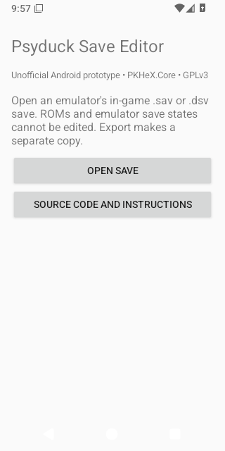
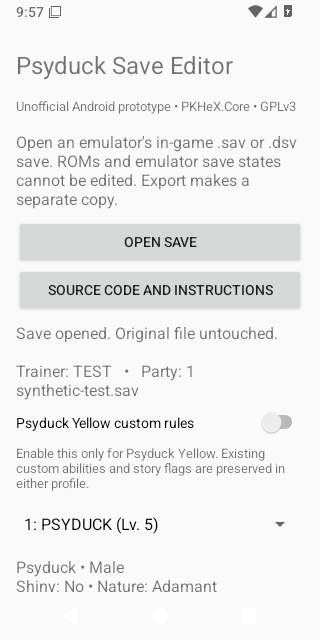

# Psyduck Save Editor for Android

An unofficial, experimental Android interface using PKHeX.Core. It starts with
**Psyduck Yellow and HeartGold/SoulSilver** emulator saves. This is a native
Android app, not the complete Windows PKHeX interface and not a Windows plugin.

## First version

- Open normal `.sav` (512 KB) and DeSmuME `.dsv` saves using Android's file picker.
- Edit party Pokémon level, friendship, all six IVs, and available abilities.
- Enable the Psyduck Yellow profile for the project's supported Hidden Abilities
  and its 1/4096 shiny interpretation. Existing custom abilities are preserved
  even when the profile is off.
- Preserve Pokémon identity, gender, shiny value, story flags, Pokédex, and the
  `.dsv` footer. Changing level/IVs recomputes party stats and heals that Pokémon.
- Validate checksums and export an **edited copy**, leaving the source untouched.

Boxes, bag editing, Pokémon creation, legality analysis, other games, and full
Windows feature parity are **not included** in this first version. Eggs cannot
be edited yet. This app does not change the ROM or its shiny encounter odds.

## Install and use

Android 8 or newer is required. Android 16 / Samsung One UI 8.5 is the owner's
primary target. The APK includes ARM64, ARM32 and x86-64 code. Download the APK
from [the Android release page](https://github.com/ThatAnarchyDude/PKHeX-Psyduck-Yellow/releases/tag/android-v0.1.1-experimental) and allow installation from that
browser/file manager if prompted. Developer Options are not required.

Version 0.1.0 passed Android 16 emulator checks but the owner reported that it
closed immediately on their Samsung phone. Version 0.1.1 provides a conservative
interpreter runtime configuration and managed startup error reporting. This is
a compatibility attempt, not a confirmed fix for that device. Download the ZIP
if a direct APK download stalls; extract it and tap the APK to install/update.
The locally published update uses the same signing key as 0.1.0.

If the app opens, **Share startup diagnostics** provides Android version,
device model, process architecture and any captured managed startup error.
It does not include a game save or trainer details. It opens Android's share
chooser; nothing is uploaded automatically. Native runtime failures before the
activity starts cannot be captured by this managed diagnostic screen.

1. Save normally in the game, then close the emulator.
2. Keep a backup of the emulator's `.sav` or `.dsv` file. Export/copy it to a
   folder Android's file picker can access, such as Downloads. Some emulators
   keep saves inside private storage that another app cannot browse.
3. Open that file in Psyduck Save Editor. Select the project profile if needed.
4. Edit a party member. Apply edits, or tap Export to apply and save a copy.
5. Import the edited copy into your emulator, using its normal save-import
   method or expected save filename. Start through the game's **Continue** menu.

A `.nds` file is the game, not the save. Emulator save states are not supported.
This app cannot bypass another app's private-storage restrictions.

## Build from source

Use this existing checkout; no separate worktree is required. Prerequisites:
.NET SDK 10 with its Android workload, a full JDK 21 (not only a JRE), and
Android SDK platform 36 / build-tools 36.0.0. Android SDK tools must be installed
from Google's official downloads with their published checksums verified.

```sh
dotnet workload install android --skip-manifest-update
python3 Android/scripts/verify_workload.py
export ANDROID_SDK_ROOT=/path/to/android-sdk
export JAVA_HOME=/path/to/jdk-21
python3 Android/scripts/build.py
```

The build helper generates an ignored development signing key under `.tools/`
if none exists. Keep that key private and retain it to sign compatible updates.
The development key password is a conventional placeholder, not a production
secret. Source builds using a different key need a reinstall; back up saves
first. Generated binaries and tools are ignored. Download releases are immutable.

A representative save regression check runs without Android:

```sh
dotnet run --project Android/EditorProbe -c Release -- /private/test-save.dsv
```

No ROMs, user saves, signing keys, or test Pokémon are distributed with the app.

## License and attribution

PKHeX and this derivative are distributed under GPL-3.0-or-later; see
[the upstream license](../LICENSE). PKHeX is developed by Kaphotics and its
contributors. This project is an independent adaptation and is not an official
PKHeX Android release. Complete corresponding source is in this repository,
including the PKHeX.Core version used by each tagged Android release.

Validation details are in [VALIDATION.md](VALIDATION.md).

## Preview




